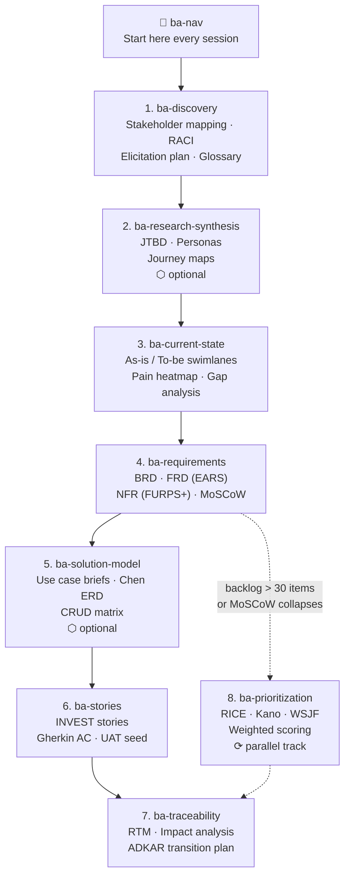

# Claude BA Skills

A suite of 9 Claude Code skills for end-to-end Business Analysis work — from project kickoff through to launch readiness.

> **New to Claude Code?** You'll need Claude Code installed and set up before using these skills.
> Get started at [claude.ai/code](https://claude.ai/code) or install via `npm install -g @anthropic-ai/claude-code`.

---

## What's included

| Skill | What it produces | When to use |
|-------|-----------------|-------------|
| **ba-nav** | Entry-point navigator — skill map + routing | Start here every session |
| **ba-discovery** | Stakeholder register, RACI, elicitation plan, glossary | Project kickoff |
| **ba-research-synthesis** | JTBD statements, personas, customer journey maps | After user interviews, before requirements |
| **ba-current-state** | As-is / to-be BPMN swimlanes, pain heatmap, gap analysis | Process documentation |
| **ba-requirements** | BRD + FRD (EARS) + NFR (FURPS+) + business rules + MoSCoW | Central requirements artifact |
| **ba-solution-model** | Use case briefs, Chen ERD, CRUD matrix | Before story breakdown when data model is implicit |
| **ba-stories** | INVEST user stories + Gherkin AC + UAT seed | Sprint planning and backlog refinement |
| **ba-prioritization** | RICE / Kano / WSJF / Weighted Scoring deep-rank | When MoSCoW collapses or backlog > 30 items |
| **ba-traceability** | RTM + impact analysis + ADKAR transition plan | End of analysis phase, pre-launch |

---

## Workflow



**Entry point:** You do not need to start from `ba-discovery`. Run `/ba-nav` and it will route you to the right skill based on where you are in your project.

**Optional skills:** `ba-research-synthesis` [2] and `ba-solution-model` [5] can be skipped if not needed for your engagement.

---

## Install

### Mac / Linux

```bash
git clone https://github.com/adi5686/claude-ba-skills.git
cd claude-ba-skills
chmod +x install.sh
./install.sh
```

### Windows (PowerShell)

```powershell
git clone https://github.com/adi5686/claude-ba-skills.git
cd claude-ba-skills
.\install.ps1
```

### Manual (any OS)

Copy each folder inside `skills/` into your Claude Code skills directory:

- **Mac / Linux:** `~/.claude/skills/`
- **Windows:** `C:\Users\<your-username>\.claude\skills\`

---

## Quick start

Once installed, open any project in Claude Code and run:

```
/ba-nav
```

The navigator will:
1. Show the full skill map
2. Check for any existing BA artifacts in your project
3. Ask 3 diagnostic questions to find your entry point
4. Route you to the right skill with context pre-filled

---

## How artifacts are organized

Every skill writes its output to a `docs/ba/` folder inside your project:

```
your-project/
└── docs/
    └── ba/
        ├── 01-discovery.md
        ├── 01a-research-synthesis.md   (if used)
        ├── 02-process-{name}.md
        ├── 03-requirements.md
        ├── 03a-solution-model.md       (if used)
        ├── 04-stories.md
        ├── 05-traceability.md
        └── 06-prioritization-{pass}.md (accumulates over time)
```

Each artifact ends with a `HANDOFF` block naming the next skill and any blockers — so you always know where to resume.

---

## ID system

All skills share a project-wide ID legend set during `ba-discovery`:

| Prefix | Meaning |
|--------|---------|
| OBJ- | Objectives |
| ST- | Stakeholders |
| BR- | Business Requirements |
| FR- | Functional Requirements |
| NFR- | Non-Functional Requirements |
| RULE- | Business Rules |
| EPIC- | Epics |
| STORY- | User Stories |
| AC- | Acceptance Criteria |
| TEST- | UAT Test Scenarios |
| CHG- | Change Requests |
| UC- | Use Cases *(ba-solution-model)* |
| ENT- | Domain Entities *(ba-solution-model)* |
| PRI- | Prioritization sessions *(ba-prioritization)* |

IDs chain across artifacts: `OBJ ← BR ← FR ← STORY ← AC ← TEST` — full traceability from business objective to test scenario.

---

## License

MIT — free to use, adapt, and share.
